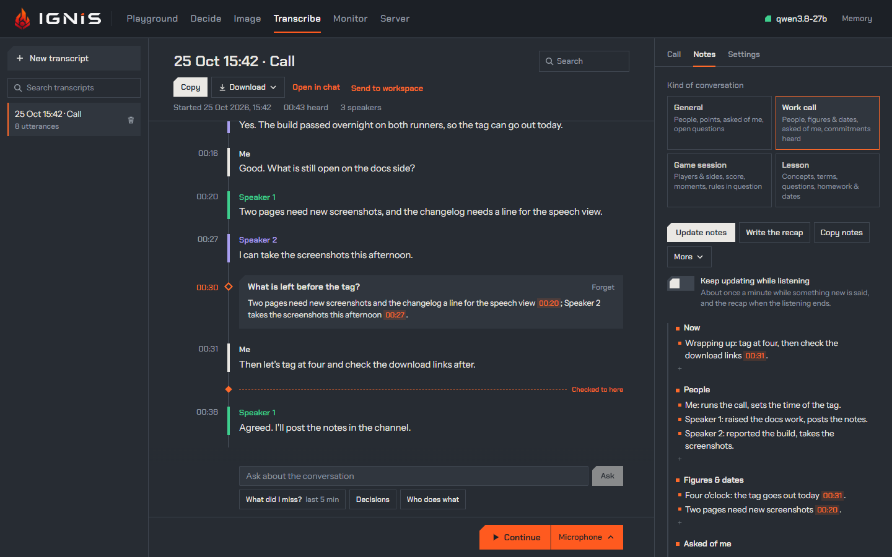

The **Transcribe** view writes a whole conversation down: a meeting in the
room, a call on this computer, or a recording. What it hears becomes a
**transcript**, its **utterances** in order, each with its time, its
**speaker** and its text. You can rename and correct the speakers and edit the
text while it listens, add pictures of what the call is looking at, have the
text model write its notes, then copy the transcript, download it, or open it
in a new chat. It uses the server's [speech model](../api/transcriptions.md) and,
for the speakers, its [diarizer](../api/realtime-transcription.md#speakers).

It is laid out like the other views: the **transcripts** on the left; the one
open in the middle, its title and exports above it and its deck at the foot;
and on the right three tabs: **Call**, what the transcription is told, its
images and who speaks; **Notes**; and **Settings**, the view's own. Below 1024 px wide the
side columns open from the header as drawers (**Call** opens the right one).

## Listening

**Start** stands in the deck at the foot, with what it listens to beside it:
press that to pick from its menu (this browser keeps the pick).

- **Microphone**: a conversation in the room, one session on the server.
- **Call**: the microphone plus one tab, window or screen the browser offers
  to share. Tick the browser's *Share audio*: a tab shares its own sound; the
  whole screen shares the system's sound (on Windows, every application's,
  mixed); a window shares its own where the browser can (Chrome 141 and
  later). The microphone and the shared audio are **two sessions, never
  mixed**: the microphone's voice is **Me**, and the shared audio's voices are
  its speakers. Through speakers, the far voices reach the microphone too:
  **Hold my mic while they speak** in Settings, on unless you turn it off (this
  browser keeps the choice, and a change holds at once), sends the microphone's session silence while the shared
  audio is loud and for half a second after, so those voices are never
  transcribed as Me; the strip marks the mic **held** meanwhile. What you say
  over the other side is lost then, so with headphones turn it off. The
  browser's own *Stop sharing* stops the listening.
- **File**: a recording you pick (wav, mp3, ogg, m4a, webm, an mp4's audio:
  whatever the browser decodes). The browser decodes it to 16 kHz mono and
  sends it faster than real time, with a progress bar and the time left. It
  stays ahead of its transcript by at most the **File pace** in Settings (45,
  60 or 90 seconds of audio not yet transcribed; 60 unless you pick another,
  kept by this browser); past that it sends an utterance still under way at
  real time, since only more audio can end it, and waits while utterances wait
  for their text. A pause in it longer than the pace is not held against it.
  With speakers, an utterance's text waits for up to 30 s of the audio after
  it, so a lower pace runs nearer real time.

While it listens, the deck is a dark strip with a level meter for each source
(Mic, and Call on a call), the time, **Pause** and **Stop**; the header shows
the listening and its time from every view, beside the model's status, and a
press on it comes back here. **Pause** lets the microphone go (a call keeps its pick, so
**Resume** needs no new one) and ends the utterance under way; **Resume** goes
on, on a new session if the server closed the old one while it was paused
(after `server.socket_idle_close`, 300 s). **Stop** waits until the server
has read the last audio sent, ends the utterance under way, waits while its
text comes (**Finishing the last words**; with speakers
the server waits for the diarizer, up to about 2.3 s live and 30 s for a file)
and closes; **Stop now** closes at once.

A transcript that already holds utterances shows **Continue** in place of
Start: the new listening appends to it, and its times go on from where it
stopped.

## Where an utterance ends

An utterance ends at a silence of **Utterance ends after** in Settings: 0.5,
1, 1.5 or 2 s, 1.5 s unless you pick another (this browser keeps it). A change
holds at once, in a listening too. The server's own default, 0.5 s, cuts a
speaker at every breath into pieces of a second or two, and the model guesses
the language of each piece on its own; a longer silence keeps a phrase whole.
With Speakers on, a change of voice ends an utterance whatever the silence.

## The text

Each utterance under way is drawn at the foot of the transcript as it is heard,
the settled words in full colour and the last ones the model may still change
light, as a [dictation](chat.md#dictating-a-prompt) draws them; it settles when
its text is complete. With speakers on, the server fixes no text before an
utterance ends, so the whole utterance under way stays light until then.

The view follows the newest words. Scroll up to read, and it stays where you
are; **Jump to live** brings it back.

The **Context** in the Call tab is what the transcription is told, and each
transcript keeps its own. **Add** or **Edit** opens a draft, framed in orange:
the **Languages**, a **Topic**, the **Terms to spell right** (names, products, jargon; Enter or a
comma adds one) and **Anything else**. Nothing is sent while you type:
**Apply** keeps it with the transcript and, while listening, tells the
sessions in one update, which holds from the next utterance; a Start applies a
draft left open. Applied, it reads as a record with the time it was applied
and about how much of the server's context it takes: the server reads
`speech.context_max_tokens` of it (512 unless set) and, past that, keeps the
last. A speaker's name you give joins the terms. An Apply changes only what the
draft changed, so a suggestion accepted while it was open stays. On a pause
with no one speaking, the model can write a line of the context in place of
what it heard; the server takes such a copy for no speech, so it leaves no
utterance ([the measurement](../../findings/2026-10-27-asr-context-echo.md)).

A transcript never started is told **your default**, once you save one: **Save
as default**, beside an applied context or in a draft, keeps it in this
browser for every new transcript; **Clear the default**, in an empty draft,
drops it. The first Start of a transcript whose context you have neither
applied nor opened asks first, your default too: over Start the deck says what
the call would be told, with **Use the context of** the latest transcript told
something else, which opens it as a draft, and **Edit the context**, and the
Call tab frames the context in orange. **Start anyway** goes on. A draft left
open asks nothing: the Start applies it.

The context reaches the text model too. The notes, the look for suggestions,
**Rewrite** and **Ask** each begin their request with it: the languages, the
terms, the topic and anything else, that "Me" is you, and the speakers by the
names you gave them, with a reminder that a sentence said as a hypothetical or
an example is not a fact about them. It also names the language to write in:
the first under **Force one**, otherwise the language heard most in the
transcript, English when nothing is known. A transcript with no context still
works; the model is told nothing was told. The context sits in the message
with the transcript, so the instructions stay the same from one request to the
next and the server can reuse them.

The **Languages** are **Detect** unless you pick **Force one**:

- **Detect**: the model detects each utterance's language, and the ones you
  list go first into the context as a hint (`Languages: Italian.`). Measured on
  read Italian cut into pieces of 1 to 2.5 s, the hint took the shortest from
  91 % to 100 % heard as Italian, as forcing does, while English speech under
  an Italian hint stayed English text ([the
  measurement](../../findings/2026-10-27-asr-language-hint.md)). Two languages
  listed help as much on Italian, but one English clip in thirty came out
  translated into Italian.
- **Force one**: every utterance is transcribed as that language (the
  session's `language`): measured, seven English clips in thirty came out
  translated into Italian under Italian forced. For a conversation in one
  language whose short utterances still come out in another.

## Context images

A **context image** is a picture of what the conversation is looking at (a
slide, a shared screen, a whiteboard) added to the transcript at a moment of
it. **Images** in the Call tab adds one three ways:

- **From a file**: a picture you pick.
- **Paste**: a picture on the clipboard, pasted (Ctrl+V) anywhere in the view
  while it shows. A paste into a text field that carries text as well is the
  field's.
- **Capture**: while a call listens into the transcript open, a frame of the
  tab, window or screen it shares, taken at the click. The browser shares the
  picture with the call's audio at Start, so Capture asks for nothing new; it
  is offered only while such a call goes on.

A picture is refused as the chat refuses one: anything but an image, or a file
over 32 MB. Before it is added, it opens full screen in the marking editor
with two tools:

- **Crop**: drag the area to keep. What is left out is dimmed; a new crop
  replaces the last.
- **Black out**: drag over what must not be kept. The area is painted solid
  black into the picture's pixels, not laid over them.

**Undo** (or Ctrl+Z) and **Clear** take the crop and the black-outs back while
you edit; **Cancel** (or Escape) adds nothing. **Add image** keeps only the
picture as shown: drawn again as a PNG, cropped, with the black-outs in its
pixels. The picture as it came, and what was under a black-out, are never
stored. It is kept in this browser with the transcript, once however many
times it is added ([Sessions and storage](sessions.md)), and nothing sends it
to a model.

Each image stands on the time spine at its moment, a small square on the rule,
with its size, and a transcript holds as many as you add. The moment is the
listening's time when the picture came in (the click on Capture, the paste,
the pick), not when it was added; with no listening it is where the
transcript stopped. A picture added before anyone has spoken holds from the
start.

## Suggestions

While a listening goes on, the Call tab suggests what the transcription could
be told, and a bell beside the tabs counts what waits:

- **the languages**, from what the server says of each utterance once six are
  in: **Detect** the one spoken, as a hint, when the others came only on
  short utterances ("2 short utterances came out as Thai and Hindi, among 9 in
  Italian"), or the ones spoken when each holds its share. It never suggests
  **Force one**: measured, the hint fixes those utterances as well and does not
  translate what is said in another language;
- **a topic**, while none is told, **a title**, while the listening's own one
  stands, and **terms to spell right**: the text model reads the transcript
  once six utterances are in, then about every minute and a half while
  something new was said, and once more when the listening ends. It checks the
  names it heard first, so a misheard name comes back spelled right
  ("Postgress" as PostgreSQL);
- **fixes**: a name, product or term the speech model misheard, `“Postgress” is
  PostgreSQL`, in every utterance that holds it as a word of its own. **Fix**
  replaces it there, marks it with a dotted orange line, and makes the right
  spelling a term, so the next utterances get it right from the start; **Undo
  fix** under an utterance puts its text back as it was heard (an edit made
  since goes with it). A fix you accepted follows the same misheard words
  into the utterances heard after it, with no model: they come as a card of
  their own, or, with **Always**, are fixed as they come; an utterance you
  undid and a fix you dismissed stay as they are. Only names and terms: the
  model is told never to rephrase.

Each waits as a card: its verb (**Apply**, **Use**, **Rename**, **Add them**,
**Fix**)
accepts it, **Dismiss** drops it for good, and **Always** accepts it and every
later suggestion of its kind in this transcript without asking. A term you do
not want is taken out with its cross, and is never suggested again. Accepting
changes the context, which is applied at once, or the title; nothing else.
**Suggest now** reads the transcript on the spot, a listening or not.
**Suggest while listening** in Settings, on unless you turn it off (this
browser keeps the choice), stops the suggestions while listening; the text
model's go to the model loaded, as the notes do.

A dashed orange line across the time spine, **Checked to here**, shows where
the text model's last look stopped reading, at the foot once it read
everything; while listening, with Suggest while listening on, it says when the
next may come ("next check in
about 45 s", or "once more is said": a look waits for three new utterances).
What is below it has not been checked yet: a Rewrite there says so, since the
next look might fix it.

## Times and speakers

Times run from the start of the transcript: `mm:ss`, and `h:mm:ss` past an
hour. An utterance starts where its speech starts and ends at the silence, the
change of speaker or the length limit that ended it. A live transcript shows
when it started; a paused listening's time stands still.

With **Speakers** on in Settings (the default; this browser keeps it, and the
next Start reads it), the diarizer tells the voices apart and
the view names them **Speaker 1, 2…** in the order they first speak, each in a
hue of its own along the time spine. Up to eight voices are told apart. On a
call the microphone's utterances are **Me**, and the shared audio's are its
speakers, or **Others** with Speakers off. With Speakers off, the room and a
file have no labels. When the server has no diarizer to offer, the toggle is
struck and says why under it: turned off (`diarizer.model =
off`), its files missing (with the `ignis-server model download` command), or
the server's reason. A diarizer the server refuses or loses during a listening
turns Speakers off for it, with its reason, and the listening goes on.

A new session numbers its voices afresh: after a Resume on a new session or a
Continue, a voice that comes back is a new speaker until you merge it into the
one it was. The Speakers panel says so once a transcript holds more than one
session.

### Correcting them

Every correction is the page's, and nothing goes back to the server:

- **Rename** a speaker in the Call tab's Speakers: every one of their utterances,
  past and future, takes the name.
- **Move** an utterance: its speaker is a menu; pick another speaker, or
  **New speaker**.
- **Merge** two speakers: **Merge into** on a speaker's row. One name is left,
  and the future utterances of either take it.
- **Rewrite** an utterance the speech model misheard: click its text, then
  **Rewrite**. The text model rebuilds what was said from the context, the
  conversation around it and how the misheard words sound, thinking a little
  (about two seconds), and proposes it under the utterance with the words it
  adds underlined and those it drops struck through: **Accept** takes it,
  keeping the text as heard behind **Undo fix**; **Discard** leaves it.
- **Delete** an utterance: click its text, then **Delete**. For a few seconds
  **Undo** at the foot of the transcript, which takes the focus and waits while
  pointed at, puts the last one deleted back where it was.
- **Split** an utterance where the diarizer missed a change: click its text,
  put the cursor where the second speaker starts, and pick the second half's
  speaker in **Split at the cursor, the rest to…**. No audio is kept, so the
  time of the split is guessed from the characters and marked `~`.

The text of every completed utterance is editable: click it, even while
listening. What you edit, and what a fix put in, is what the exports, the notes
and Open in chat carry.

## Searching

**Search** beside the title (or Ctrl+F while the view shows) lights every
occurrence in the transcript open, whatever the case and the accents
("perche" finds "perché"), the one it stands on in orange, and says where it
is, "3 of 12". Enter or the arrows beside it go to the next, Shift+Enter or
the up arrow to the previous, Escape clears; the view stops following the newest
words meanwhile.

**Search transcripts** above the list keeps the transcripts that hold the query,
in their text or their title, each with its count of matches; opening one
carries the query into its own search.

## The transcript

Each transcript is kept in this browser as each utterance completes, with its
text, times, speakers and corrections and its context images, and never its
audio ([Sessions and storage](sessions.md)). Its title is the date, the time and the
source, "25 Oct 15:42 · Call" (a file's name for a file); click it to rename
it. **New transcript** starts another; the bin on a row deletes one, except
the one listening, with the pictures no other transcript or view still uses. A reload keeps every completed utterance and ends the
listening; so does a lost connection.

## Out of the view

Beside the title, **Copy** puts it on the clipboard, and **Download** writes it
as:

| Format | Each utterance |
|---|---|
| `.txt` (and Copy) | `[mm:ss] Speaker: text`, one line each |
| `.md` | `**Speaker** (mm:ss): text`, after the title and the start, with the notes and Ask's answers (below) |
| `.srt` | a numbered cue from its start to its end, `Speaker: text` |
| `.vtt` | a cue from its start to its end, `<v Speaker>text` |

The `.md` also carries what the view keeps beside the utterances. Under the title and the start come the **recap**, when the transcript has one, or else the running notes, each in its sections (`## Summary`, and so on, a section with no line shown as `—`), then a `## Transcript` heading over the utterances. Each answer Ask gave stands between the utterances at the moment it was asked, as a quoted block whose first line is the question in bold; an answer kept without a moment stands at the end. A transcript with no notes and no answers writes the `.md` as the table says. `.txt`, `.srt` and `.vtt` never carry notes or answers: they stay the transcript alone, so a tool reading them keeps working. Open in chat and Send to workspace use the same Markdown.

**Open in chat** opens a new chat with the transcript as Markdown in its prompt
box. Nothing is sent until you press Send: ask for a summary, the decisions,
the action items.

**Send to workspace** asks which workspace, a new one named after the transcript or one you already have, and adds the transcript to it as a Markdown file, the very text the `.md` download writes, so the model can read it in a chat whose workspace it is. A name the workspace already holds gets a number, as any file you add does. The transcript stays here as it was; the file is a copy, and a later correction does not reach it until you send again.

## Asking about it

The field at the foot of the transcript, over the deck, asks the text model
about it, while listening too. **What did I miss?** asks what was said in the last five minutes,
**Decisions** what was decided and what is still open, **Who does what** who
agreed to do what, each answered in the conversation's language; a question you
type is answered in the language the context names. Come back to the page after a minute or more away
from it (another tab, another window) while it listens, and **What did I
miss?** reads from what you had last seen instead, its button saying since
when. While a text model serves, a time on the left of the transcript picks
the moment it reads from; press it again, or Escape, for the last five
minutes. Pointing at the button
colours, on the time spine, what it will read; once asked, it reads the last
five minutes again. The answer streams in on the time spine where you
asked, after the last utterance it read, that moment's time in orange beside
it, and stays there while the conversation goes on under it; **Forget** drops
one. It reads the transcript alone, so a word heard wrong stays wrong in it.
Answers are not searched, nor exported. A moment named as `[mm:ss]`, in an
answer or in the notes, is a link: click it and the transcript shows that
utterance, lit for a moment.

## Notes

The **Notes** tab has the text model loaded read the transcript and write its
notes. Pick the **kind of conversation** first; each asks for its own sections:

| Kind | Sections |
|---|---|
| General | Summary, Key points, Next steps |
| Work call | Summary, Topics, People, Decisions, Action items, Open questions |
| Game session | Games, Players, Results, Highlights |
| Lesson | Topics, Key concepts, Questions, To review |

**Write notes** sends the transcript as it stands, and the notes stream in
under those headings, as written above; the text under them is in the
language the context names, a moment is pointed at as `[mm:ss]`, and a section with
nothing in it is a dash. **Update notes** writes them again from the whole
transcript, so a correction holds; **Stop** leaves the notes there were. The
line under them says when they were written, from how many utterances, and how
many came since. **Copy notes** puts them on the clipboard as Markdown; once
there is a [recap](#the-recap), the button is **Copy recap** and copies that.
Each transcript keeps its notes and its kind; a new one starts at the kind
picked last (this browser keeps it).

**Keep updating while listening**, off unless you turn it on (this browser
keeps the choice), writes them by itself while a listening goes on: the first
once three utterances are in, then about once a minute while something new is
said. When the listening ends it writes the recap instead. Picking another kind
meanwhile writes them again straight away.

### The recap

The **recap** is the notes written once from the whole conversation, for what
comes after it. Notes kept up a minute at a time help while the conversation
goes on, but weigh the first minutes' talk as much as the rest; the recap
weighs the decisions, the action items and the open questions against
everything that was said. It is written:

- by itself when a listening ends with **Keep updating while listening** on,
  in place of the notes' last writing, unless a recap of the same kind already
  covers every utterance;
- on **Write the recap**, at any moment, from the transcript as it stands.

It has the kind's sections, with a few more:

| Kind | The recap adds |
|---|---|
| Work call | Figures & dates, after People: every figure said, with what it refers to and when |
| Lesson | Terms, after Key concepts, each with its meaning; Homework & dates, after To review |

Its Summary and Topics carry the main threads by the weight the conversation
gave them, not every aside; Decisions are what was agreed, Action items what
someone committed to do, and People everyone who spoke or was named. It reads
the context and the whole transcript afresh: the notes the model wrote are not
sent, so a mistake made in them live does not carry over into the recap.

Once there is a recap, it stands at the top of the tab with the line saying
when it was written and from how many utterances, and the notes fold under it
as **Running notes**; click to open them. While it is written it streams in
there, and **Stop** keeps the recap there was. A new recap takes the last one's
place. Each transcript keeps its recap, and a reload brings it back.

Nothing goes to the model before a press or the switch. The notes and the recap go to the
model loaded and name none, so they never switch models: with the image model
loaded, or none serving, the tab says so and writes nothing. Each writing is a
chat completion on an agent's lane (`class: "agent"`), thinking off, that waits
while every lane is taken; the transcript is its user message after the title,
so a later writing starts with the text the last one sent, which the server can
reuse. One writing goes at a time, the notes' or the recap's; a recap may take
up to 3,000 tokens, twice the notes'. A transcript too
long for the model's context is sent from where its tail fits, and the line
says from when.

## While it listens

The microphones of the other views are struck and say **Listening in
Transcribe.**: they open no second session. A dictation under way when a
listening starts ends as it does when another mic is pressed, and its text
lands in its field.

The line under the deck follows along:

| When | It says |
|---|---|
| before a call | Use headphones on a call: through speakers, the far voices reach the microphone and are transcribed twice. |
| every session taken | Speech is busy: every session is taken. Trying again in N s. |
| refused again | The listening still could not open: speech is busy. Press Start to try again. |
| the connection closed | Listening stopped: the connection to the server closed. Every completed utterance is kept. |
| nothing shared, or no audio shared | Nothing was shared: … / The pick shares no audio: … |
| an utterance failed | An utterance could not be transcribed: *the server's reason*. |
| a file's end | Transcribed *name*. |
| the server is up but the socket never opened | Listening could not start: the server is up, but this address does not carry WebSockets. |

An unavailable speech model, a microphone the browser blocks and a page served
outside https or localhost say what they say for a [dictation](chat.md#dictating-a-prompt);
a file needs no microphone, so it starts outside https too.

## What a listening sends

Each source is one session on `GET /v1/realtime?intent=transcription`
([Realtime transcription](../api/realtime-transcription.md)), opened at Start
and closed at Stop; a call takes two of the server's `speech.max_sessions` (4).
Each asks for:

- **the server's turn detection with the view's silence**: `turn_detection:
  {type: "server_vad", silence_duration_ms: <the setting>}`, the threshold and
  the padding the server's (`speech.vad_*`), and every commit is an utterance;
  a change of the setting is a `session.update` of the turn detection;
- **16-bit PCM at 16 kHz**, 100 ms of audio at a time (a file's faster);
- **the provisional tail** (`session.ignis.provisional_tail: true`);
- **the speakers**, with Speakers on: `session.ignis.diarization: "live"`, or
  `"file"` for a file, the diarizer's geometry for audio sent faster than real
  time. A call's microphone never asks: it is Me;
- **each utterance's language** (`session.ignis.item_language: true`), which
  the language suggestion reads; a server older than it refuses the key, and
  the session is configured again without it;
- **what it is told**: the topic and anything else as the transcription's
  `prompt`, the terms and the speakers' names you gave as its `keywords`, and a
  `session.update` of them at an Apply or a rename.

It sends no `session.ignis.max_utterance_seconds`, so the server's length guard
(`speech.max_utterance_seconds`, 120 s) cuts a long utterance at its weakest
pause. A file's append the server refuses for its queue limit
(`ignis_audio_queue_full`) is sent again from there a moment later, after
the file's end too.

**Cost.** A microphone left open sends silence, so its session never idles,
and with speakers the diarizer reads all of it: measured at about a fifth of a
ten-core desktop CPU, more on four cores. Pause stops it. Listenings of hours
have not been measured.

## Read more

- [Realtime transcription](../api/realtime-transcription.md): the events behind the view, the speakers and the queue.
- [Speech configuration](../configuration/speech.md): the speech model, the diarizer, the length guard.
- [Chat](chat.md#dictating-a-prompt): dictating into a prompt.
