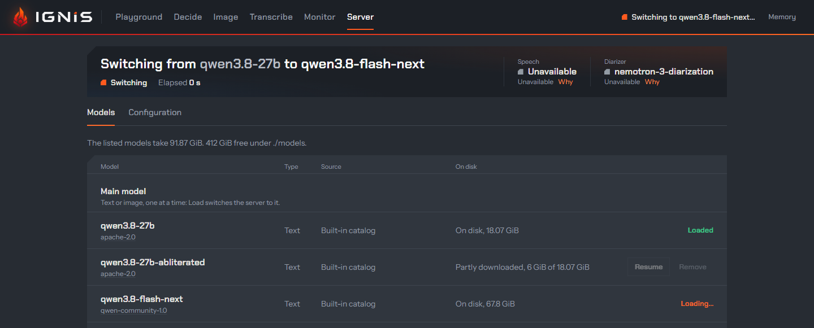

One card holds one model at a time, and the model that is loaded gets all of
it. ignis turns that constraint into behaviour a client does not have to manage.
A request that names another known model **switches the server to it and is held
until it serves**, so there is no retry loop to write. After five minutes
without a request the model is unloaded and the card is free for other work; the
next request loads it again. The process, the listener, the metrics and the
Playground stay up throughout.

## How it works

A load carves the card's whole budget into one plan: weights, workspaces, lane
state, and then everything that is left goes to the KV pool, or to Flash-Next's
expert cache. Two models would each need a plan, so a switch is a full reload:
the server drains the requests in flight (`switch.drain_timeout`), unloads, and
loads. `POST /v1/models/switch` does it explicitly. A request whose `model`
names another known model triggers the same switch (`switch.allow_implicit`)
and waits for it. `GET /v1/models` lists the loaded model first, then every
model whose weights are on disk; a model whose weights are gone is a 404 and
never tears the loaded one down.

Idle unload applies the same teardown on a timer. After `model.idle_unload`
seconds with no request in use and nothing waiting or running, the model is
unloaded and `GET /v1/models` shows `status: "unloaded"`. Routes that only
report state (the model list, the configuration and catalog reads, `/metrics`)
neither count as use nor load the model, so an open Playground tab does not hold
it. The ADR weighed keeping the weights in pinned RAM, refusing until an
explicit load, and exiting, and rejected each.

Models arrive through a catalog. `ignis-server model download <id>` reads an
entry that pins every file at a revision with its byte count and SHA-256, so a
download is verified before it is used. `download.catalog` extends the catalog
for private models, and `download.endpoint` points at a mirror that answers the
Hugging Face resolve route (Artifactory, Nexus, a static server) for air-gapped
machines. The whole picture is in
[Switching and idle unload](../concepts/switching-and-idle-unload.md).

## The numbers

| Figure | Measured on | Source |
|---|---|---|
| 27B to the image model **10.0 s** (server side 9,962 ms: teardown 908, load 9,021); image model back to the 27B **11.3 s** (server side 11,246 ms) | RTX 5090, one live run | [Image serving spec, as built, issue #322](https://github.com/gpillon/ignis/issues/322), the live run of 2026-10-14 |
| A cold load takes 13-33 s, which is what the first request after an idle unload pays | RTX 5090 | [ADR 0049](../../adr/0049-an-idle-model-is-unloaded-and-loads-again-on-demand.md) |
| `model.idle_unload` 300 s, `switch.drain_timeout` 30 s | defaults | [Configuration](../reference/configuration.md#modelidle_unload) |

:::caution[A switch starts cold]
A switch discards the old load's retained prompt state, its pinned KV-RAM and
its pools. The next request on the model you switch back to prefills from
scratch. Requests that arrive during a load wait for it, and a load that fails
leaves `status: "failed"` and answers the waiting requests with
`503 model_load_failed`.
:::

## See it, control it

- **Switching**: [`switch.allow_implicit`](../reference/configuration.md#switchallow_implicit),
  [`switch.known_models`](../reference/configuration.md#switchknown_models) and
  [`switch.drain_timeout`](../reference/configuration.md#switchdrain_timeout);
  `POST /v1/models/switch`, and `GET /v1/models` with its `status`
  (`serving`, `switching`, `loading`, `unloaded`, `failed`) and `last_switch`.
- **Idle unload**: [`model.idle_unload`](../reference/configuration.md#modelidle_unload),
  300 s by default and `0` for never.
- **The catalog**: `GET /v1/models/catalog`, `ignis-server model download <id>`,
  [`download.endpoint`](../reference/configuration.md#downloadendpoint) and
  [`download.catalog`](../reference/configuration.md#downloadcatalog).
- **Logs**: `ignis.model.switch_started`, `ignis.model.loaded`,
  `ignis.model.unloaded`, `ignis.model.reloaded`, `ignis.model.load_failed` and
  `ignis.model.switch_failed`. The VRAM and KV pool gauges read zero while
  unloaded.
- **Playground**: the [Server view](../playground/server.md) loads models and
  edits the running configuration.

## Limits

- There is never a second model on the card, not even the 27B beside the image
  model.
- The first request after an idle period pays a full load of 13-33 s. Benchmarks
  and anything latency-sensitive should set `model.idle_unload` to `0`.
- Alternating `model` strings across clients makes the server ping-pong between
  models. Name one model per client; the
  [pitfall of two names](../concepts/switching-and-idle-unload.md) explains it.

## Read more

- [Switching and idle unload](../concepts/switching-and-idle-unload.md): the full picture.
- [Switching models](../api/model-switching.md) and [Get a model](../guides/models.md): the routes and the download.
- [Air-gapped machines](../guides/air-gapped.md): the catalog on a mirror.
